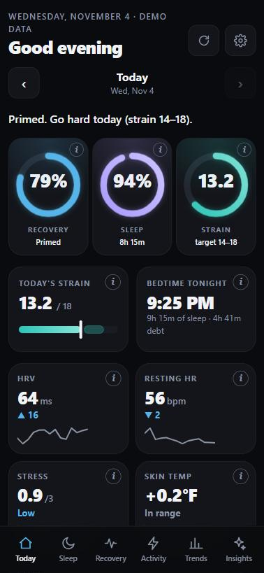
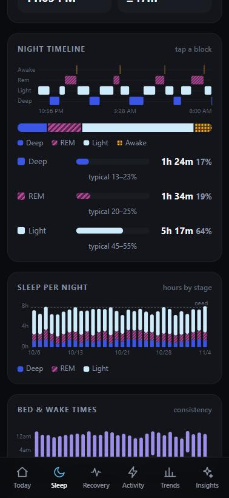
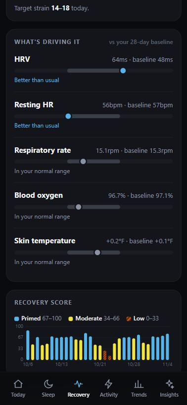
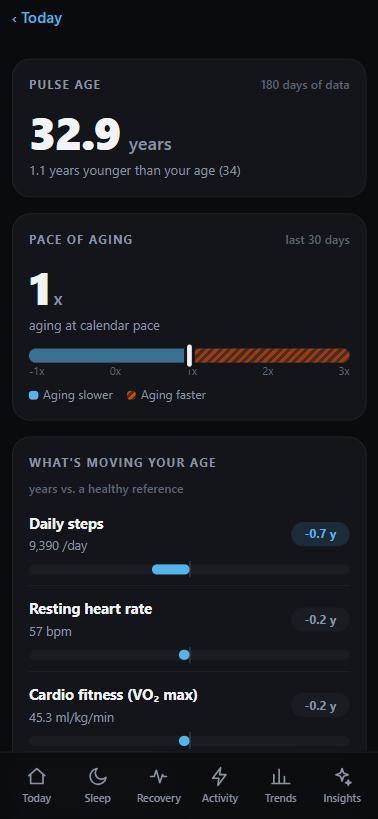

# Pulse

**WHOOP-style recovery, sleep and strain for your Fitbit. Free, private, and self-hosted.**

Pulse turns the data your Fitbit already collects into a daily readiness score, a sleep plan, a strain target, a biological-age estimate and plain-English advice. There is no subscription and no company in the middle. It runs on free tiers of services you own, behind your own password, and stores your data in your own database.

<p align="center">
  
  
  
  
</p>
<p align="center"><sub>Screenshots use the built-in demo data. Try it yourself in one command: <code>npm run demo</code>.</sub></p>

---

## Why this exists

Fitbit users have good hardware and good raw data, but the polished "what should I do today?" layer lives behind paid subscriptions, or in apps built for other wearables. Google's new [Google Health API](https://developers.google.com/health) makes that data available to you, so Pulse builds the missing layer on top of it and keeps everything under your control.

- **Free.** Everything runs on free tiers (see [costs](#what-it-costs)).
- **Private.** One user, one password, your own database. No analytics, no ads, no third-party data sharing.
- **Transparent.** Every score is a documented formula you can read and change. See [How it works](docs/HOW-IT-WORKS.md).
- **Works on your phone.** It installs to your iPhone or Android home screen and opens like an app.

> Pulse is an independent project. It is **not affiliated with or endorsed by Google, Fitbit, WHOOP, Oura or Bevel**, and its scores are estimates, not their algorithms. See the [disclaimer](#disclaimer).

## Features

| | |
|---|---|
| **Today** | One-screen glance: headline, Recovery / Sleep / Strain rings, today's strain target, tonight's bedtime, key vitals, your Pulse Age and anything that needs attention. |
| **Recovery** | A 0-100% score from overnight HRV, resting heart rate, breathing rate, blood oxygen and skin temperature against your own 28-day baseline, plus the factors that move it. |
| **Sleep** | Performance score (duration, efficiency, restorative sleep, consistency), stage timeline, a sleep-need plan with debt and a target bedtime. |
| **Activity** | Strain (0-21) from heart-rate zones, steps, active zone minutes, workouts with zone breakdowns, and daytime stress. |
| **Healthspan** | A transparent biological-age estimate ("Pulse Age") and pace of aging, built from published mortality research, with the habits that would change it most. |
| **Insights** | Analysis of *your* data with practical steps: sleep debt, bedtime effects, hard-day cost, evening-workout effects, illness flags and more. |
| **Trends** | 7 / 30 / 90-day views, this week vs last, a recovery calendar. |
| **Weekly review** | What went well, what to watch and one focus for next week. |
| **AI coach** *(optional, free)* | A morning briefing and chat that answers questions using your real numbers. |
| **Notifications** *(optional, free)* | Morning briefing, bedtime reminder and weekly review, via the ntfy app. No accounts or keys. |
| **Accessibility** | Color-blind-safe palette (patterns plus color), adjustable text and display size, tap-to-explain on every score. |

Also: date navigation to any past day, a data-health screen that shows which metrics are arriving, an offline fallback, and a clear "reconnect" banner if your Google login ever lapses.

## What it costs

| Piece | What it's for | Cost |
|---|---|---|
| [Vercel](https://vercel.com) Hobby | Hosts the app and runs the daily sync | Free for personal projects |
| [Neon](https://neon.tech) Postgres | Stores your data | Free plan |
| [Google Cloud](https://console.cloud.google.com) project | Lets you authorize the Google Health API for your own account | Free to set up; no billing needed for personal-scale use |
| [ntfy](https://ntfy.sh) | Phone notifications | Free |
| [Groq](https://console.groq.com) | Optional AI coach | Free tier, no card |

Limits and prices change, so check each provider's current terms.

## Try it in one minute (no accounts)

```bash
git clone https://github.com/NisargPatel119/pulse.git
cd pulse
npm install
npm run demo          # http://localhost:3002 with realistic made-up data
```

Demo mode needs no database, login or Google account and never reads real data.

## Deploy your own

You need a free Vercel account, a free Neon database and a free Google Cloud project. The full walkthrough, with every setting, is in **[docs/SETUP.md](docs/SETUP.md)**. In short:

1. **Deploy** this repo to Vercel (button below) and add **Neon** from the project's Storage tab.
2. **Create a Google Cloud project**, enable the Google Health API, set up the OAuth consent screen, **publish it to production** and create a Web OAuth client with your app's `/api/oauth/callback` as the redirect URI.
3. **Add the Google keys** (`GOOGLE_CLIENT_ID`, `GOOGLE_CLIENT_SECRET`) to Vercel, redeploy, open your app, and tap **Connect Fitbit**.
4. **Add it to your home screen.**

[](https://vercel.com/new/clone?repository-url=https%3A%2F%2Fgithub.com%2FNisargPatel119%2Fpulse&env=APP_PASSWORD,CRON_SECRET&envDescription=APP_PASSWORD%20is%20the%20password%20you%20sign%20in%20with%20(make%20it%20long).%20CRON_SECRET%20is%20any%20long%20random%20string.%20Your%20Google%20keys%20and%20database%20are%20added%20afterwards%2C%20see%20docs%2FSETUP.md.&envLink=https%3A%2F%2Fgithub.com%2FNisargPatel119%2Fpulse%2Fblob%2Fmain%2Fdocs%2FSETUP.md&project-name=pulse&repository-name=pulse)

Why do I have to create my own Google Cloud project? Google requires every app that reads Fitbit data to be registered. Registering one shared app would put everyone's health data behind a single account and require a formal Google security review. Creating your own takes about 15 minutes, once, and keeps your data entirely yours.

## How it works

```
Fitbit Air / Fitbit ──Bluetooth──▶ Google Health app ──▶ Google Health API
                                                              │  (read-only, your own OAuth login)
                                                              ▼
        your phone ◀── web app (Next.js on Vercel) ◀── your Neon Postgres
            ▲                     │
            └── ntfy notifications ┘
```

- Your band syncs to the Google Health (Fitbit) app on your phone. Pulse can only show what Google has received, so keep background sync enabled on your phone.
- Pulse reads that data, stores it in **your** database, and computes the scores in the app. It refreshes when you open it, once a day via cron, and re-checks automatically while it is waiting for a new night's sleep.
- Nothing is sent anywhere else, except the optional AI coach (a short numbers-only summary to Groq) and notifications (short text through ntfy).

The scoring methods and the research behind them are documented in **[docs/HOW-IT-WORKS.md](docs/HOW-IT-WORKS.md)**.

## Project layout

```
public/            the app UI (vanilla JS, no framework): views, charts, explain sheets, service worker
src/lib/           data and logic: Google Health client, scores, insights, healthspan, weekly review
src/app/api/       routes: data, OAuth connect/callback, prefs, notify, cron jobs
src/app/privacy/   the public privacy policy page that Google's consent screen links to
docs/              setup guide, how-it-works, screenshots
```

## Limitations

- **One person per deployment.** There is a single password and no multi-user support.
- **Estimates, not WHOOP's algorithms.** Recovery, strain and Pulse Age follow published research and common practice but are not WHOOP's, Oura's or Google's proprietary scores. Use the trends and the advice more than any single number.
- **Depends on Google.** Data appears only after your band syncs to the Google Health app, and the Google Health API is new, so some response details may change.
- **Google's "unverified app" screen** appears once when you connect, because your personal Google Cloud app is not verified. That is expected for a personal app.

## Contributing

Bug reports, fixes and ideas are welcome. Please read [CONTRIBUTING.md](CONTRIBUTING.md). Security issues: see [SECURITY.md](SECURITY.md).

## Disclaimer

Pulse provides general wellness information and is **not a medical device**. It does not diagnose, treat or prevent any condition. Talk to a clinician about health concerns. Fitbit and Google are trademarks of Google LLC; WHOOP, Oura and Bevel are trademarks of their respective owners. They are mentioned only to describe what Pulse is similar to, and none of them is affiliated with this project.

## License

[MIT](LICENSE)
